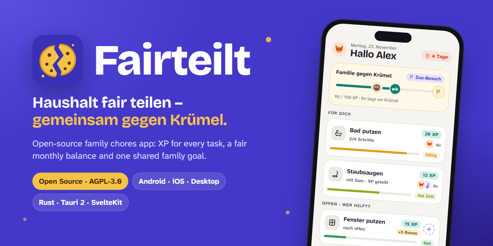
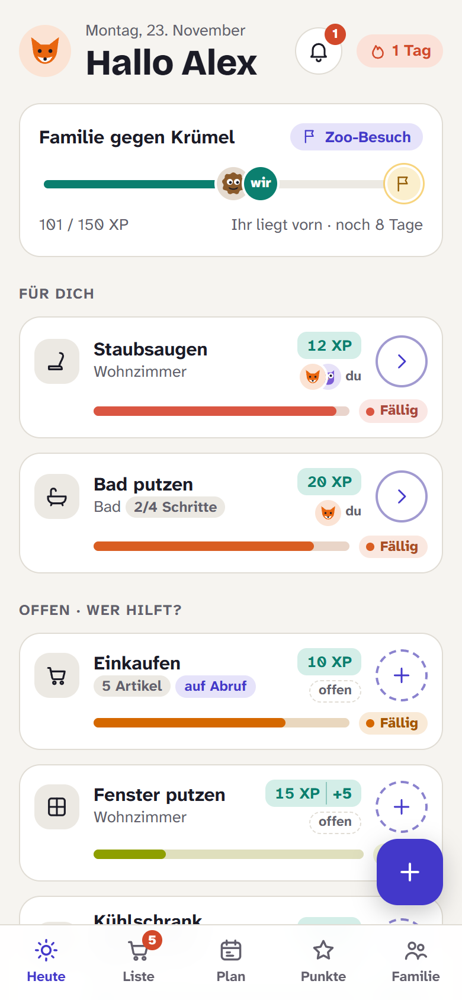
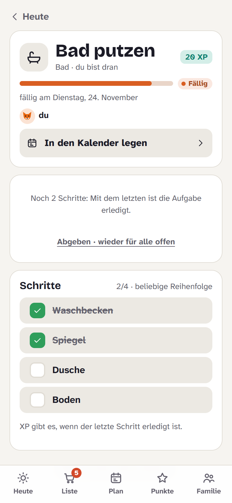
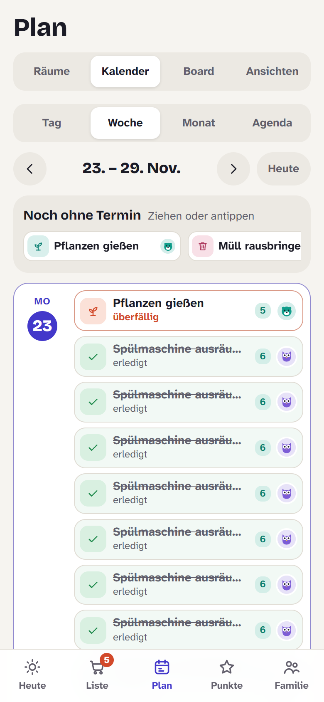
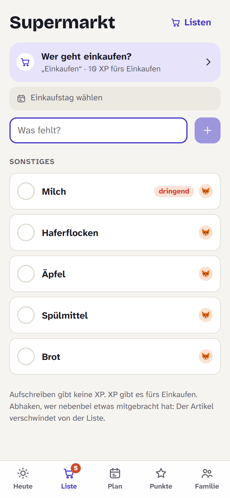
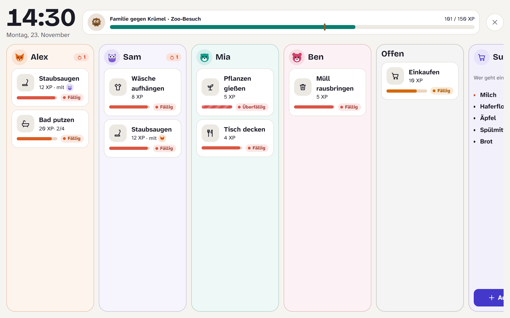
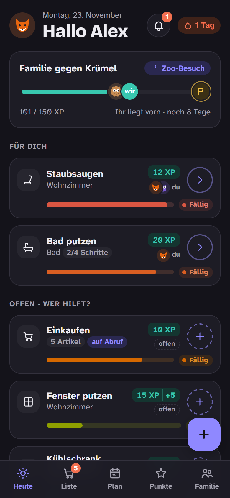
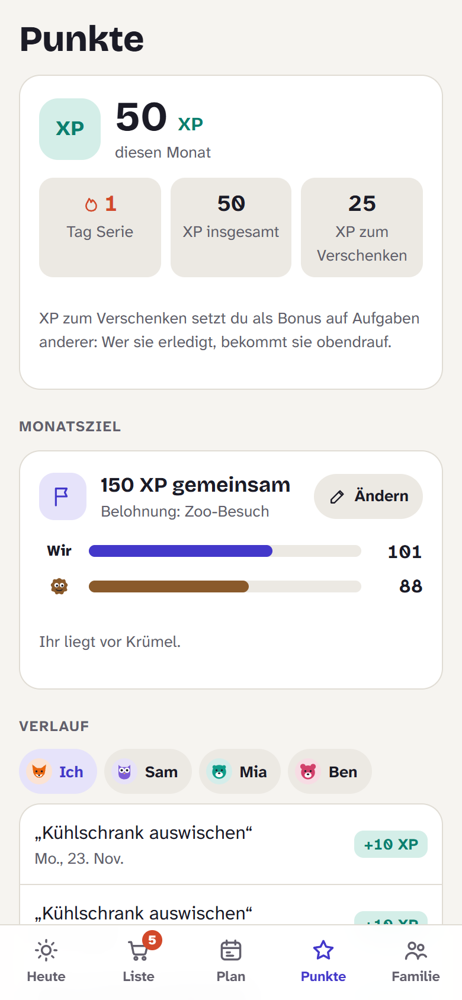

<p align="center">
  
</p>

<p align="center">
  <a href="https://github.com/SchulzOli/fairteilt/actions/workflows/ci.yml"></a>
  <a href="LICENSE"></a>
  
  
  
  
</p>

<p align="center">
  <b>Fairteilt</b> ist eine freie Familien-App für Haushaltsaufgaben.<br>
  Jede Aufgabe bringt XP, am Monatsende gleicht Fairteilt aus, wer mehr und wer weniger getragen hat,<br>
  und alle zusammen rennen gegen das Maskottchen <b>Krümel</b> um ein gemeinsames Familienziel.
</p>

<p align="center">
  <a href="#funktionen">Funktionen</a> ·
  <a href="#so-funktionierts">So funktioniert's</a> ·
  <a href="#schnellstart">Schnellstart</a> ·
  <a href="#selbst-hosten">Selbst hosten</a> ·
  <a href="#mitmachen">Mitmachen</a> ·
  <a href="#in-english">English</a>
</p>

---

<table>
  <tr>
    <td align="center"><br><sub><b>Heute</b>: Familienziel und deine Aufgaben</sub></td>
    <td align="center"><br><sub><b>Aufgabe</b>: Schritt für Schritt</sub></td>
    <td align="center"><br><sub><b>Plan</b>: Kalender, Board, Räume</sub></td>
    <td align="center"><br><sub><b>Liste</b>: gemeinsam einkaufen</sub></td>
  </tr>
</table>

<p align="center">
  <br>
  <sub><b>Wandanzeige</b> fürs Familien-Tablet: eine Spalte pro Person, abhaken mit Tier und PIN</sub>
</p>

## Warum Fairteilt?

In vielen Familien bleibt der Haushalt an wenigen hängen, und wer ihn trägt, merkt es meist zuerst.
Fairteilt macht die Arbeit sichtbar, ohne daraus einen Wettkampf zu machen: Es gibt **keine
Rangliste**, sondern ein Ziel, das alle nur gemeinsam erreichen. Wer im Monat hinten liegt, bekommt
keine Strafe, sondern **Aufholaufgaben**. Und weil Kinder anders mithelfen als Erwachsene, zählt jede
Person nach ihrem eigenen **Gewicht**.

## Funktionen

- **Räume und Rhythmen.** Aufgaben kehren von selbst wieder: an festen Tagen, „alle 7 Tage nach dem
  letzten Mal“ oder auf Abruf. Ein Balken zeigt in vier Stufen, wie dringend sie sind: Gut, Hat Zeit,
  Fällig, Überfällig.
- **XP und Serien.** Erledigen bringt XP, mit Konfetti in der Karte und einem warmen „Ding-Ding!“.
  Schritte („Waschbecken, Spiegel, Dusche …“) lassen sich einzeln abhaken.
- **Gemeinsam anpacken.** Mit „+“ übernimmst du eine Aufgabe oder machst bei einer fremden mit; die
  XP werden geteilt. Auf ungeliebte Aufgaben kann jede Person einen **XP-Bonus** verschenken.
- **Fairer Ausgleich.** Am Monatsende rechnet Fairteilt aus, wer über oder unter seinem fairen Anteil
  lag. Rückstand und Vorsprung wandern in den nächsten Monat oder werden zu Aufholaufgaben. Alle Regeln
  sind pro Haushalt einstellbar.
- **Familienziel gegen Krümel.** Krümel rückt jeden Tag ein Stück vor, liegengebliebene Aufgaben
  schieben ihn an. Wer zuerst am Ziel ist, entscheidet über die Familienbelohnung.
- **Für Kinder gemacht.** Tiere statt Fotos, Anmeldung mit Kinder-Code oder PIN auf dem Familien-Tablet,
  Bestätigung durch Eltern mit anpassbaren Punkten.
- **Plan.** Kalender (Tag, Woche, Monat, Agenda), freies Board mit Zonen, eigene Ansichten. Alles per
  Ziehen und Ablegen.
- **Einkaufsliste.** Alle schreiben auf, wer einkauft, bekommt XP. Live-Hinweis „Noch mitbringen?“
  an die Person im Laden.
- **Erinnerungen und Push,** pro Kategorie abschaltbar, mit Ruhezeiten.
- **Offline-fest.** Änderungen warten in einer Warteschlange und gehen raus, sobald wieder Netz da ist.
- **Deine Daten.** Kein Tracking, keine Werbung. Export als Datei, Konto und Haushalt in der App
  löschbar, Server selbst hostbar.

<p align="center">
  
  &nbsp;&nbsp;
  
  <br><sub>Hell und dunkel gleichwertig gestaltet · Punkte mit Serie, Bonus-Budget und Monatsziel</sub>
</p>

## So funktioniert's

```text
Aufgabe erledigt ──▶ XP (geteilt, wenn mehrere mitmachen) ──▶ Punktebuch
                                                                  │
Monatsende ◀───────────── fairer Anteil je Person (Gewicht, Abwesenheit) ◀─┘
     │
     ├── im Rahmen (± Toleranz) ............ nichts
     ├── Rückstand ......................... Übertrag oder Aufholaufgaben
     └── Vorsprung ......................... senkt das Ziel im nächsten Monat
```

Die Regeln stecken in der Rust-Bibliothek [`punkte-core`](crates/core): rein, ohne IO und mit Tests.
Server und App rechnen damit dasselbe, die App sogar offline. Die Details stehen im
**[Konzept](docs/KONZEPT.md)**.

## Technik

| Teil | Womit |
| --- | --- |
| App | [Tauri 2](https://tauri.app) für Android, iOS und Desktop, Oberfläche in [SvelteKit](https://svelte.dev) (Svelte 5, TypeScript) |
| Server | Rust mit [axum](https://github.com/tokio-rs/axum) und PostgreSQL ([sqlx](https://github.com/launchbadge/sqlx)), WebSocket für Live-Updates, Job-Scheduler in der Datenbank |
| Regeln | [`crates/core`](crates/core): Punkte, Zustand, Ausgleich, Rennen gegen Krümel; TypeScript-Typen per [ts-rs](https://github.com/Aleph-Alpha/ts-rs) erzeugt |
| Push | Firebase Cloud Messaging (optional), sonst Postfach und lokale Erinnerungen |
| Betrieb | Docker Compose, Caddy, nächtliche Backups, Server-Image aus der CI |

```text
app/            SvelteKit-Oberfläche + Tauri-Kern (app/src-tauri)
crates/core/    punkte-core: alle Regeln, rein und getestet
server/         punkte-server: REST-API, WebSocket, Scheduler, Migrationen
deploy/         Dockerfile, Compose, Caddy, Backup- und Update-Skripte
docs/           Konzept, Roadmap, Betrieb, Entwicklung, Store
```

## Schnellstart

Voraussetzungen: Rust (stable), Node 22+, [pnpm](https://pnpm.io), Docker.

```bash
git clone https://github.com/SchulzOli/fairteilt.git && cd fairteilt
docker compose -f deploy/docker-compose.dev.yml up -d          # PostgreSQL
cp server/.env.example server/.env && cargo run -p punkte-server
pnpm --dir app install && pnpm --dir app dev                   # http://localhost:1420
```

Als App auf dem Rechner: `pnpm --dir app tauri dev`, auf dem Android-Handy:
`pnpm --dir app tauri android dev`. Tests, API-Übersicht, Push und Android-Setup stehen in
**[docs/ENTWICKLUNG.md](docs/ENTWICKLUNG.md)**.

## Selbst hosten

Ein kleiner VPS reicht. Der Server läuft als Docker-Image aus der CI
(`ghcr.io/schulzoli/fairteilt-server`) hinter Caddy, mit nächtlichem Backup und automatischen
Updates nach grüner CI. Schritt für Schritt: **[docs/BETRIEB.md](docs/BETRIEB.md)**.

## Stand und Roadmap

Fairteilt ist in der **Familien-Alpha**: Es läuft im echten Familienalltag, die Store-Versionen folgen.
Was fertig ist und was als Nächstes kommt: **[docs/ROADMAP.md](docs/ROADMAP.md)**.

## Mitmachen

Ideen, Fehlerberichte und Pull Requests sind herzlich willkommen, auch auf Englisch.
Lies am besten zuerst **[CONTRIBUTING.md](CONTRIBUTING.md)** und schau nach
[`good first issue`](https://github.com/SchulzOli/fairteilt/issues?q=is%3Aopen+label%3A%22good+first+issue%22).
Sicherheitslücken bitte vertraulich melden, siehe [SECURITY.md](SECURITY.md).

## In English

**Fairteilt** (German for "shared fairly") is a free, open-source family chores app. Every task earns
XP, a monthly balance shows who carried more or less of the housework (weighted per person, so kids
count fairly), and the whole family races together against the mascot *Krümel* towards a shared
reward. No leaderboards, no ads, no tracking. Built with Tauri 2 (Android, iOS, desktop), SvelteKit
and a Rust (axum + PostgreSQL) server you can host yourself. The app is in German for now;
contributions, including translations, are very welcome.

## Lizenz

Copyright (C) 2026 SchulzOli

Fairteilt ist freie Software unter der [GNU Affero General Public License v3.0 oder später](LICENSE).
Wer den Server verändert und anderen als Dienst anbietet, muss den geänderten Quellcode ebenfalls
bereitstellen. Die Klänge für „Krümel überholt“ und „Familienziel erreicht“ sind aus
„Music Jingles – Pizzicato 02“ von Kenney (CC0) transkribiert.
